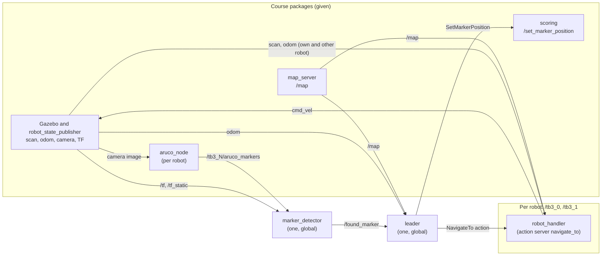
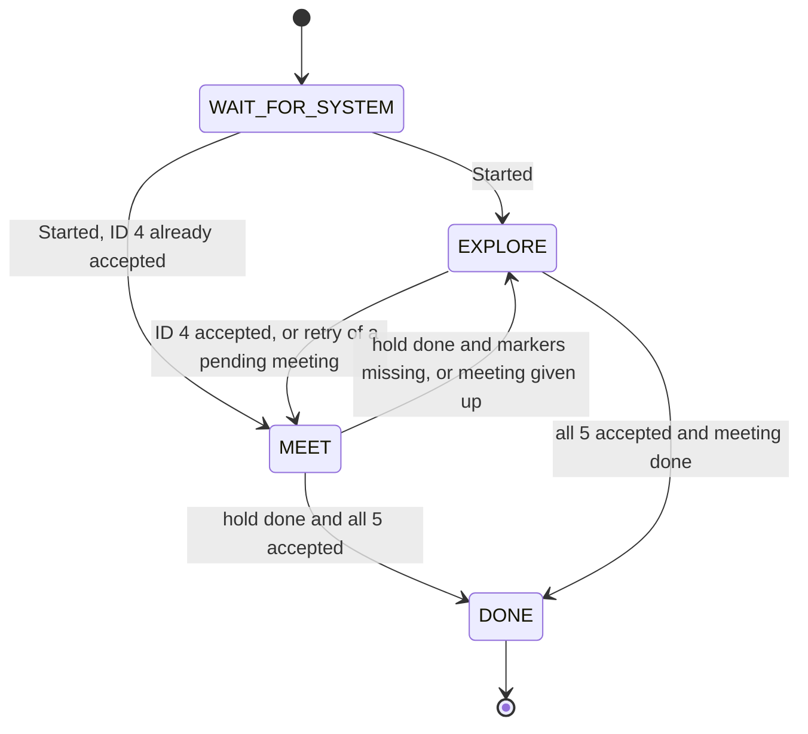
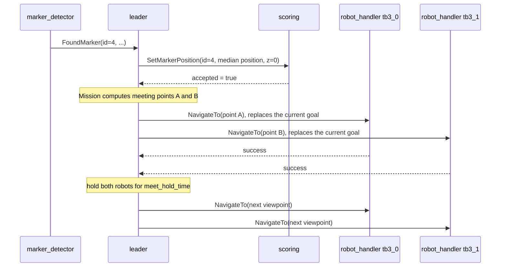

# Architecture

This document describes the design of our Search & Rescue system for the DAT160
semester project. The ROS interfaces in §4 are the **contract** between the
parts of the system and are frozen after milestone M0. Everything else may
change through an ordinary pull request.

- Build and run instructions: [README.md](README.md)
- Modules, classes and methods: [docs/CODE_STRUCTURE.md](docs/CODE_STRUCTURE.md)
- Work plan: [docs/ISSUES_OVERVIEW.md](docs/ISSUES_OVERVIEW.md)

---

## 1. Requirements from the assignment

These are mandatory. Every design decision below must respect them.

| # | Requirement | Source |
|---|---|---|
| R1 | A team of at least 2 TurtleBot3 robots (camera, lidar, IMU, wheel encoders) solves the task in Gazebo. | Competition page |
| R2 | All robots start in the start zone. | Competition page |
| R3 | Time limit is 10 minutes (600 s). | Competition page |
| R4 | One of 5 world variants is chosen at random. The blueprint map is known; marker positions are not. | Competition page |
| R5 | Pre-programmed paths are not allowed. Paths must be computed at runtime. | Competition page |
| R6 | Findings are reported through the ROS 2 service `/set_marker_position` (`scoring_interfaces/srv/SetMarkerPosition`). | Competition page |
| R7 | The navigation algorithm must be one we have implemented ourselves to a significant degree, not an existing one used as-is (§6, §8, §9; issues labelled `impl:own`). | Competition page |
| R8 | The report must explain how the robots communicate, which navigation algorithm runs, and how both are implemented. | Competition page |
| R9 | The repository must contain instructions on how to run the project (it is run on the organisers' competition PC). | Competition page |
| R10 | Each group member keeps a work log. | Course information |

### Scoring

| Marker ID | Meaning | Points |
|---|---|---|
| 0, 1, 3 | Small fire | +100 each |
| 2 | Injured person | +100 |
| 4 | Big fire | +100 when reported, +300 if two robots are within 2 m of it at any time after it has been accepted |

The final score is `600 − t + marker points`, where `t` is the elapsed time in
seconds (§2).

**Priority.** The clock only stops when the big fire has been accepted, the
meeting has happened and all five markers are accepted (§2). A single missing
marker removes the whole time bonus, so finding every marker reliably comes
before driving fast.

---

## 2. Facts from the course code

Found by reading `ros2_students_25` (packages `multi_robot_challenge_23`,
`multi_robot_scoring` and `ros2_aruco`), the map and world files, and the
ROS 2 Foxy sources. Items marked **verify** are confirmed in simulation
(SPK-01, SPK-02).

| Topic | Fact | Consequence for the design |
|---|---|---|
| Final score | `600 − elapsed_seconds + marker_points` | Speed matters, but only once all markers are found. |
| Time base | Elapsed time is measured with the wall clock (`time.time()`), not simulation time. | A low real-time factor costs points directly. The Gazebo GUI and RViz are off in competition runs, and the real-time factor is recorded in every test run. |
| Clock start | Starts when any robot's odometry differs by more than 0.1 m or 0.1 rad from its spawn pose read from Gazebo. Until odometry arrives, the robot position defaults to (0, 0). | Computation done before the first movement costs no time (§8.1, §11). Scoring is started after the robots publish odometry. |
| Clock stop | Only when ID 4 is accepted, the meeting has been detected and all five IDs are accepted. Otherwise the clock runs to 600 s. | The meeting is required for any time bonus. |
| Accuracy | A report is accepted if it is within **0.5 m in 3D** of the marker model's origin. **Verified in SPK-01:** 0.30 m off sideways is accepted with z = 0 and rejected with z = 0.45 (3D error 0.54 m). | See "Marker model". |
| Marker model | The origin is on the floor. The plate is 0.5 × 0.5 m, from z = 0 to z = 0.5, centred on the origin and textured on both faces. Markers, fires and the baby model have no collision geometry. | A detection gives the plate centre at z ≈ 0.25. Reporting `z = 0` matches the origin and leaves the full 0.5 m for the horizontal error. The lidar does not see markers. |
| Wrong report | Rejected without penalty. A repeated report of an accepted marker also returns `accepted = false`, without any log line in scoring; an inaccurate position or an invalid ID is logged as an error (verified in SPK-01). No report is accepted after the run has ended. | Retry with a better estimate; never report an accepted marker again (§7.2). |
| Meeting check | Evaluated every 0.5 s, after ID 4 has been accepted, as the 2D distance from the robots to the true marker position. Walls between robot and marker do not matter. The robots get no feedback; only the score that scoring prints rises by 300. | Hold both robots at the meeting points for a few seconds (§9). |
| Ground truth | Each world file contains two different poses per marker (the `<state>` block and the model definition). | The positions that scoring prints at start-up are the ground truth for tests. The simulation and our nodes are restarted between test runs instead of using "Reset World". |
| Worlds | Five worlds, each with its own blueprint map, with bounding boxes from 13 × 15 m to 20 × 10 m. The walls in the world files match their blueprint within a few centimetres. Simulation time does not start at zero in these worlds. | Apart from the other robot there are no obstacles that the blueprint does not show, so the planning grid stays fixed during a run (§6.1). Timers only use time differences. |
| Start poses | Different in each world (for example (0, −1) and (0, 1) in w1, (0, −0.5) and (0, −2.5) in w5). Both robots face +x. | No positions in the code. The launch file holds the spawn poses per world; our nodes read the start poses from odometry. |
| Odometry | `map → tb3_N/odom` is a static identity transform. The diff-drive plugin sets no `odometry_source`, so it uses the plugin default (world). **Verified in SPK-01:** after about 7 m of driving with turns and pushing against a wall, `/tb3_0/odom` and the Gazebo model pose (`/gazebo/get_entity_state`) differed by less than 0.1 mm and 0.0001 rad. | `/tb3_N/odom` is the ground-truth pose in the `map` frame. No localisation filter is needed. |
| TF in Python (Foxy) | The Python `TransformListener` subscribes to the relative topics `tf` and `tf_static`, while all broadcasters publish on `/tf` and `/tf_static`. | A namespaced Python node with a TF listener receives no transforms. The marker detector is one global node (§7.1). |
| Map | `/map` (`nav_msgs/OccupancyGrid`), 2000 × 2000 cells, 0.01 m/cell, origin (−10, −10). Published once by `map_server` with transient-local durability. | Subscribe with `TRANSIENT_LOCAL` QoS. Downsample before planning (§6.1). |
| Marker placement | At ground level, mostly in alcoves and short dead ends, facing into the alcove. | A marker is often visible only from inside or in front of its alcove. Viewpoints lie close to walls (§8.1). |
| Lidar | `/tb3_N/scan`: 360 samples over 0–2π, 5 Hz, range 0.12–3.5 m, invalid readings `inf`. Mounted 0.064 m behind `base_footprint` in TF; the ray origin may lie 0.128 m behind with newer SDFormat versions. **Verified in SPK-01:** compared with the 1 cm map straight ahead and behind, the ray origin is 0.067 m behind (median of 9, noise about ±0.01 m), so the TF value 0.064 m holds. | The front sector wraps around angle 0. The offset is the parameter `lidar_offset_x`. The lidar also sees the other robot (§6.6). |
| Robot geometry | The rotation centre is `base_footprint`. The 0.266 m body is centred 0.064 m behind it; the wheels reach ±0.153 m sideways. | The robot sweeps a radius of about 0.24 m when it turns in place, which sets the inflation radius (§6.1). |
| Camera | 640 × 480, 30 Hz, horizontal field of view (HFOV) ≈ 62°, vertical ≈ 49°, about 0.10 m above the floor, frame `tb3_N/camera_rgb_optical_frame`. | **Measured in SPK-02** (marker 4, w1): detected from **1.0 m** (closer, the top edge of the plate leaves the image) to at least **3.5 m**, and up to 75° from the plate normal at 1.5 m. Position error grows with distance: 3 mm at 1 m, 1.2 cm at 2 m, 4.5 cm at 3.5 m. Standing still, `aruco_node` reports 15–20 detections per second over UDP, but only 0.5–4 with Fast-DDS shared memory (§7.1, Q6). The robot sees a narrow cone ahead, so it looks around at viewpoints (§6.8). |
| ArUco | Dictionary `DICT_5X5_250`, marker size 0.5 m. `aruco_node` (one per robot) publishes `/tb3_N/aruco_markers` only when a marker is visible, with the image timestamp and an **empty** `frame_id`. Poses use the optical-frame convention. | The detector names the frame `tb3_N/camera_rgb_optical_frame` itself and looks up the transform at the image time (§7.1). |
| Course `marker_pose.py` | Started as `marker_recognition` by the course `spawn_robot.launch.py`, once per robot without a namespace. Uses only `marker_ids[0]`, and after the first detection republishes the last camera-frame pose, transformed with the *current* camera pose, every 0.1 s. ID and pose are published on two separate topics, `/tb3_N/marker_id` and `/tb3_N/marker_map_pose`. | A second marker in the same image is lost, and positions are wrong after the marker leaves the view or while the robot turns. We use our own `marker_detector` (§7.1) instead of `marker_map_pose`; the report explains why. |
| Course world launch | Always starts RViz. `map_server` needs `nav2_lifecycle_manager`. `spawn_robot.launch.py` reads a `use_sim_time` argument that it does not declare. | Our launch file starts Gazebo, the map server and the robots itself and declares `use_sim_time` (§12). |
| Scoring world plugin | Only the world files in `multi_robot_scoring/worlds/` contain the `gazebo_ros_state` plugin that scoring needs. | They are copied over the challenge world files (see README). |

---

## 3. System overview

The design is **centralised**: one `leader` node owns the mission. Each robot
runs its own `robot_handler` in its namespace, and one global
`marker_detector` handles the camera detections of both robots.



| Node | Running instances | Namespace | Responsibility |
|---|---|---|---|
| `leader` | 1 | global | Start-up check, viewpoints, allocation, marker register and reporting, big-fire meeting, end of the mission. The decisions are made by the `Mission` state machine (§5). |
| `robot_handler` | 1 per robot (same code) | `/tb3_N` | Action server `navigate_to`: plans a path with a distance transform, follows it, stops for unexpected obstacles, recovers when stuck, applies the rules for two robots and rotates at viewpoints (§6). |
| `marker_detector` | 1 | global | Transforms the ArUco detections of every robot to the `map` frame at the image time and publishes sightings (§7.1). |

Each node is **one class written once**, and the code never contains a robot
name. `robot_handler` uses relative topic names and reads its robot name from
its namespace. `leader` and `marker_detector` run without a namespace and create
one subscription or client per robot from the `robots` parameter, which the
launch file sets for all nodes. The meeting needs exactly two robots (§9).

### Architecture style

The system is a **hybrid** architecture in three layers:

| Layer | Where | What |
|---|---|---|
| Deliberative | `leader`, `robot_handler` | Viewpoints, allocation and meeting points (leader) and the path to each goal (robot_handler), all computed from the blueprint map with distance transforms |
| Executive | `leader` (`Mission`) | State machine that sequences start-up, exploration, the meeting and the end of the mission |
| Reactive | `robot_handler` | Lidar safety stop, stuck recovery and right of way between the robots |

### Why centralised

- One node has the full picture, which makes allocation and the meeting simple.
- The mission logic can be tested without Gazebo (§5).
- A single point of failure is acceptable in simulation.

Decentralised coordination, for example robots that claim viewpoints from each
other, was considered and rejected: it is harder to test and to reason about
within the project's time frame, and it gives no benefit with two robots on a
reliable simulated network.

---

## 4. Interfaces

All custom types live in the `rescue_interfaces` package (`ament_cmake`).
They are frozen after milestone M0; a change needs a pull request.

### `action/NavigateTo.action`

```
# Goal
geometry_msgs/Point target    # map frame; z is ignored
bool spin_on_arrival          # rotate at the target to look for markers (§6.8)
---
# Result
bool success
string message                # "reached", "no path", "stuck", "peer", "preempted" or "cancelled"
---
# Feedback
float32 distance_left         # metres along the planned path, for logging
```

| `message` | Meaning |
|---|---|
| `reached` | Target reached, and the spin done if requested. The only result with `success = true`. |
| `no path` | No path to the target, also without the other robot's disc (§6.6). |
| `stuck` | No progress after `max_replans` recoveries (§6.5). |
| `peer` | Held by the other robot for `peer_wait_timeout` (§6.6). |
| `preempted` | Replaced by a newer goal (§6.7). |
| `cancelled` | Cancelled by the leader. |

### `msg/FoundMarker.msg`

```
std_msgs/Header header        # stamp = image time, frame_id = "map"
int8 marker_id                # 0–4
geometry_msgs/Point position  # plate centre in the map frame
float32 distance              # camera-to-marker distance in metres
string robot                  # "tb3_0" or "tb3_1"
```

`distance` lets the leader prefer close sightings, which are more accurate
(§7.2).

### `scoring_interfaces/srv/SetMarkerPosition` (course, not ours)

```
int8 marker_id
geometry_msgs/Point marker_position   # map frame; we report z = 0
---
bool accepted
```

### Topics, services and actions

| Name | Type | Publisher / server | Subscriber / client |
|---|---|---|---|
| `/map` | `nav_msgs/OccupancyGrid` | `map_server` (course, transient local) | `leader`, `robot_handler` |
| `/tb3_N/scan` | `sensor_msgs/LaserScan` | Gazebo | `robot_handler` |
| `/tb3_N/odom` | `nav_msgs/Odometry` | Gazebo | `robot_handler` (own and other robot), `leader` |
| `/tb3_N/cmd_vel` | `geometry_msgs/Twist` | `robot_handler` | Gazebo |
| `/tb3_N/aruco_markers` | `ros2_aruco_interfaces/ArucoMarkers` | `aruco_node` (course) | `marker_detector` |
| `/tf`, `/tf_static` | `tf2_msgs/TFMessage` | Gazebo, `robot_state_publisher`, static `map → tb3_N/odom` (course) | `marker_detector` |
| `/found_marker` | `rescue_interfaces/FoundMarker` | `marker_detector` | `leader` (queue depth 50) |
| `/tb3_N/navigate_to` | `rescue_interfaces/action/NavigateTo` | `robot_handler` | `leader` |
| `/set_marker_position` | `scoring_interfaces/srv/SetMarkerPosition` | `scoring` (course) | `leader` |

`robot_handler` uses relative names (`scan`, `odom`, `cmd_vel`, `navigate_to`)
so that its namespace is applied, and absolute names for `/map` and the other
robot's `/tb3_N/odom`. The global nodes use absolute names built from the
`robots` parameter.

### Communication patterns (report, R8)

| Pattern | Used for | Why |
|---|---|---|
| Topic | Sensor data, `cmd_vel`, `/found_marker` | Continuous or event streams, many-to-one, no answer needed. |
| Service | Reporting to scoring | Short request with a single answer. |
| Action | `leader → robot_handler` navigation | Long-running task with a result, which can be cancelled or replaced by a new goal (for example when the meeting starts). |

---

## 5. Mission logic (`leader`)

The mission is a plain Python class, `Mission` in `core/mission.py`, with no
ROS imports and no clock. It receives **events** and returns **commands**. The
`leader` node is an adapter: it turns ROS callbacks into events and executes the
commands as ROS calls.

```
ROS callback ──► Event ──► Mission.handle(event) ──► [Command, ...] ──► ROS call
```



### 5.1 Events, commands and deadlines

| Event | Fields (every event also carries `now`) | Sent by the leader when |
|---|---|---|
| `Started` | `robots`, `passes` | The system is ready (§11). `passes` holds the viewpoints of pass 0 and pass 1 (§8.1). |
| `GoalFinished` | `robot`, `goal_id`, `success` | A `NavigateTo` result arrives, or a goal is rejected |
| `MarkerAccepted` | `marker_id`, `all_accepted` | Scoring accepts a report (§7.2) |
| `Tick` | — | The mission timer fires (`tick_rate`) |

| Command | Executed by the leader as |
|---|---|
| `SendGoal(robot, goal_id, target, spin)` | `NavigateTo` goal. A new goal replaces the robot's current goal (§6.7). |
| `CancelGoal(robot)` | Cancel request for the robot's active goal |
| `Finish()` | Log the result; nothing more is sent |

`Mission` is created with the allocator (§8.2), a cost function that returns the
travel distance from a robot to a point, a function that computes meeting points
(§9), and the parameters `meet_hold_time`, `meet_max_attempts`,
`goal_timeout_base`, `max_linear_speed` and the spin time.

Every `SendGoal` carries a new `goal_id` and gets a **deadline**. Let `cost` be
the travel distance from the robot to the target and `spin_time` the spin
timeout `2 · spin_angle / spin_speed` (§6.8):

```
deadline = now + goal_timeout_base + 3 · cost / max_linear_speed  (+ spin_time if the goal spins)
```

A result with an old `goal_id` is ignored. A goal whose deadline has passed is
cancelled and handled as a failure, so a lost result or a robot that never
finishes cannot stall the mission.

`Mission` keeps, per robot, the active `goal_id`, its target and its deadline,
and for the mission the pass index, `meeting_pending`, `meeting_done`,
`all_accepted`, and for the meeting `meet_attempts`, `meet_exclude`, the meeting
targets, `arrived` and `hold_start`.

### 5.2 Transitions

| State | Event | Action | Next state |
|---|---|---|---|
| WAIT_FOR_SYSTEM | `MarkerAccepted` | Record it; ID 4 → `meeting_pending = True` | WAIT_FOR_SYSTEM |
| WAIT_FOR_SYSTEM | `Started` | Load pass 0. If the meeting is pending, `try_start_meeting`; if still in EXPLORE, `assign` | EXPLORE or MEET |
| EXPLORE | `GoalFinished` | `complete(robot, success)` in the allocator; `assign` | EXPLORE or MEET |
| EXPLORE | `MarkerAccepted(4)` | `meeting_pending = True`; `try_start_meeting` | MEET or EXPLORE |
| EXPLORE | `MarkerAccepted` (other ID) | Record it; if all five are accepted and the meeting is done → finish | EXPLORE or DONE |
| EXPLORE | `Tick` | Expired goals → `CancelGoal` and handle as failure; if all five are accepted and the meeting is pending → `try_start_meeting`; `assign` | EXPLORE or MEET |
| MEET | `GoalFinished`, success | Add the robot to `arrived`; both arrived → `hold_start = now` | MEET |
| MEET | `GoalFinished`, failure, or a deadline passed on `Tick` (→ `CancelGoal`) | Add the target to `meet_exclude`; `meet_attempts += 1`. Below `meet_max_attempts`: new points with `meeting(meet_exclude)`, send only the targets that changed and remove those robots from `arrived`. At the limit, or if no points are found: `assign` (the meeting stays pending) | MEET or EXPLORE |
| MEET | `Tick`, `hold_start` set and `now − hold_start ≥ meet_hold_time` | `meeting_done = True`, `meeting_pending = False`; all five accepted → finish; otherwise `assign` | DONE or EXPLORE |
| MEET | `MarkerAccepted` (other ID) | Record it | MEET |
| any | `GoalFinished` with an old `goal_id` | Ignore | — |
| DONE | any | Ignore | DONE |

### 5.3 Helper rules

- **`try_start_meeting`**: set `meet_attempts = 0` and compute
  `points = meeting(meet_exclude)`. If there are none, clear `meet_exclude` and
  try once more. Still none: stay in EXPLORE with the meeting pending. Otherwise
  release both robots' reservations (§8.2), send both robots to their points
  without spin, clear `arrived` and `hold_start`, and enter MEET. The points are
  computed before anything is released, so a failed attempt leaves exploration
  untouched.
- **`assign`** (EXPLORE only): for every robot without an active goal, take the
  next viewpoint from the allocator. If there is none and no free viewpoint is
  left, load the next pass (0, 1, 0, …). If the meeting is pending, call
  `try_start_meeting` first and stop if it entered MEET; otherwise ask once more.
  A robot that still gets nothing waits for the next event or tick.
- **Retry of the meeting**: after `meet_max_attempts` failed attempts the robots
  explore again. While the meeting is pending it is retried, with `meet_exclude`
  kept, at every pass switch and on every tick once all five markers are
  accepted.
- **Finish**: `CancelGoal` for every active goal, then `Finish()`; the state
  becomes DONE.

Marker reporting is not part of `Mission`. The leader keeps the marker register
(§7.2), sends reports on every tick and dispatches `MarkerAccepted` when scoring
accepts one. ID 4 can be accepted at any time, also before `Started`.

---

## 6. Navigation (`robot_handler`) — our own implementation (R7)

### 6.1 Planning grid

1. Read `/map` (0.01 m/cell).
2. Downsample to `grid_resolution` (0.10 m). A coarse cell is occupied if any
   fine cell inside it is occupied, and unknown cells count as occupied. This is
   the **static grid**, 200 × 200 cells instead of 4 million.
3. Inflate the occupied cells by `inflation_radius` (0.30 m). This is the
   **planning grid**, in which the robot can be treated as a point
   (configuration space). The robot turns in place around `base_footprint`, and
   its body reaches about 0.24 m from that point because the body is centred
   0.064 m behind it (§2). The rest is a margin for control errors.
4. Both grids are built once and do not change during the run (§2, Worlds). The
   lidar is only used by the reactive layer (§6.5).

### 6.2 Path planning: distance transform

The planner follows the distance transform in Corke, *Robotics, Vision and
Control*, chapter 5.

Let `h` be the cell size, `S` the set of source cells and `N(c)` the eight
neighbours of a cell `c`. The step length `ℓ(c, n)` is `h` to an orthogonal
neighbour and `√2 · h` to a diagonal neighbour. A diagonal step is only allowed
if both orthogonal cells beside it are free, so a path never cuts the corner of
an obstacle. The cost `D(c)` of a free cell is the shortest travel distance to
the nearest source:

```
D(s) = 0                              for every source cell s in S
D(c) = min over n in N(c) of  D(n) + ℓ(c, n)     for every other free cell c
```

Blocked cells have `D = ∞`, and so do free cells that no source can reach. The
field is computed by **repeated relaxation**: start with `D = 0` at the sources
and `∞` everywhere else, then update every cell from its neighbours, with NumPy
array shifts, until no value changes.

**Why a distance transform.**

- The grid does not change during the run, so a plan never needs to be repaired,
  and a full recomputation for every new plan is fast enough on the 0.10 m grid.
  D\*, which repairs plans incrementally when the map changes, would add
  complexity without benefit.
- The grid is small, so sampling-based planners (PRM, RRT) offer no advantage,
  and their random paths would need smoothing.
- The TurtleBot3 turns on the spot, so the turning-radius handling of a lattice
  planner is not needed.
- A graph search such as A\* finds one path between two cells. One distance
  transform gives the distance from the sources to **every** cell, and the same
  function serves five purposes:

| Use | Sources | Blocked cells | Result used |
|---|---|---|---|
| Path to a goal (`robot_handler`, §6.3) | Goal | Planning grid, plus the other robot's disc (§6.6) | Steepest descent from the robot |
| Allocation cost (`leader`, §8.2) | Robot | Planning grid | Travel distance to every viewpoint |
| Reachable viewpoints (`leader`, §8.1) | Both start positions | Planning grid | Viewpoints that can be reached |
| Wall distance (`leader`, §8.1) | All occupied cells of the static grid | None | Viewpoints close enough to a wall, with room to rotate |
| Meeting points (`leader`, §9) | Each robot | Planning grid | Travel distance to every meeting candidate |

### 6.3 Path

1. **Snap.** Start and goal are moved to the nearest free cell of the planning
   grid. A robot that stands close to a wall may be inside the inflated area.
2. **Descent.** With the goal as source, the path steps from the start cell to
   the neighbour with the lowest cost until it reaches the goal (steepest
   descent), with the same corner rule as the field.
3. **Line-of-sight simplification.** From each kept point, the path jumps to the
   farthest later point that can be reached in a straight line without crossing
   a blocked cell (checked every quarter cell). This removes the 45° zig-zag of
   an 8-connected path and leaves points only at corners. The check uses the same
   blocked cells as the plan.

### 6.4 Path following

Go-to-point controller (assignment A3a; Corke chapter 4, "moving to a point").
Let `(x, y, θ)` be the robot pose in the map frame and `(x*, y*)` the current
path point. The distance is `d = √((x* − x)² + (y* − y)²)` and the heading error
is `e = wrap(atan2(y* − y, x* − x) − θ)`, wrapped to `[−π, π]`. With
`k_h = heading_gain`, `k_d = distance_gain` and `v_max = max_linear_speed`:

```
turn   if |e| > turn_threshold:   v = 0                        ω = k_h · e
drive  otherwise:                 v = min(v_max, k_d · d)      ω = k_h · e
```

`ω` is limited to ±`max_angular_speed`. The robot is non-holonomic and cannot
move sideways, so it first turns towards the point. Because `v` is proportional
to `d` near the point, the robot slows down and reaches intermediate points
within `waypoint_tolerance` (0.05 m) without overshooting. The final point
counts as reached within `goal_tolerance` (0.10 m). The control loop runs every
0.05 s inside the action's execute callback.

### 6.5 Reactive layer: lidar safety stop and stuck recovery

**Safety stop.** Each scan is converted to map-frame points in its callback,
with the latest odometry and the sensor offset `lidar_offset_x`. Points that lie
on known walls (the static grid grown by one cell) and points within
`peer_ignore_radius` of the other robot are dropped. While the robot drives
forward, it stops if a remaining point lies ahead of it, closer than
`obstacle_stop_distance` and within ±`obstacle_half_width`, and it waits as
long as the point is there.

- Points on known walls are dropped because the planning grid allows paths
  0.30 m from a wall. Otherwise the robot would stop next to every wall it
  passes.
- Nothing is added to the grid. The worlds contain no obstacles that the
  blueprint does not show (§2), and a temporary obstacle in the grid could close
  a corridor. A blockage that does not go away is handled by the stuck recovery.

**Stuck recovery.** A progress monitor checks that the remaining path length
drops by at least `stuck_min_progress` within `stuck_timeout`. It is reset only
by a new plan and while the robot waits for the other robot (§6.6), not by
turning in place, so a robot that turns back and forth without progress is also
detected. When the robot is stuck, it stops, reverses up to `reverse_distance`
at `reverse_speed` while the rear lidar sector (walls included) is clear beyond
`obstacle_stop_distance` and the other robot is not within 0.6 m behind it, and
plans again. The other robot is checked from its odometry, because the lidar
may look over its body. After `max_replans` recoveries the goal ends with
`stuck`. If no path exists at all, the goal ends with `no path`.

### 6.6 Two robots on one map

Neither the blueprint nor the planner knows where the other robot is. Each
`robot_handler` subscribes to the other robot's odometry (from the `robots`
parameter) and applies four rules, implemented as pure functions in
`core/traffic.py`.

1. **Disc in every plan.** Every plan blocks a disc of radius
   `peer_plan_clearance` (0.60 m) around the other robot's current position,
   for that plan only. If the goal lies inside the disc, or the disc leaves no
   path, the robot plans without it.
2. **Conflict.** Let `p` be my position, `q` the other robot's position and `s`
   a point of my remaining path within `path_lookahead` (1.0 m) along the path.
   There is a conflict if some `s` is closer than `peer_stop_clearance` (0.50 m)
   to `q` **and** closer to `q` than I am now (`|s − q| < |p − q|`). Driving away
   from the other robot is therefore always allowed, even when the robots are
   already close. There is no conflict while the other robot moves away from me
   faster than 0.1 m/s and the gap is at least 0.7 m. Its velocity in the map
   frame is its odometry twist rotated by its heading, because the twist is
   given in the robot's own frame.
3. **Right of way.** On a conflict the robot stops. The robot that comes first
   in `robots` has right of way and waits until the conflict is gone. The other
   robot plans again with the disc; if a path exists it takes the detour,
   otherwise it waits.
4. **Timeout.** A robot that has been held by conflicts for `peer_wait_timeout`
   (10 s) acts. Without right of way it ends its goal with `peer`, so the target
   stays available to the other robot and the leader gives it another one. With
   right of way it plans again with the disc and keeps its goal. The timer
   resets only when the conflict clears. Plans caused by conflicts are made at
   most once per second and do not count as recoveries; the mission deadline
   (§5.1) bounds the waiting.

### 6.7 Goal handling

- The action server is created only when the map and the robot's own pose are
  known.
- `goal_callback` accepts every goal, and `cancel_callback` accepts every cancel
  request.
- **One goal at a time.** `handle_accepted_callback` makes the new goal the
  active one and starts it. Before every velocity command the control loop
  checks that its goal is still the active one; if not, it ends with
  `preempted` without publishing. A new goal therefore replaces the old one
  without an explicit cancel.
- **Result.** `reached` → `succeed()`; a cancel request → `canceled()`; every
  other end, including `preempted` → `abort()`. `canceled()` is only allowed
  after a cancel request.
- The loop runs inside try/finally, which publishes zero velocity only if the
  goal is still the active one, so an old goal never stops the robot after a new
  goal has taken over. The robot also stops before every plan. Per-goal state is
  kept in local variables.

### 6.8 Spin at viewpoints

With `spin_on_arrival`, the robot rotates `spin_angle` at `spin_speed` after
reaching the target. The angle is 2π − HFOV ≈ 5.2 rad, because the camera
already covered the field of view ahead while the robot approached. The angle is
accumulated from the odometry yaw. The spin ends after twice the nominal time at
the latest and can be preempted and cancelled like the rest of the goal.

**SPK-02 finding:** detection while turning continuously is unreliable. Detections
per full turn at 1.5 m varied between runs: 22–51 at 0.3 rad/s, 17–20 at 0.5 rad/s,
1–16 at 0.8 rad/s and 0–8 at 1.0 rad/s or more. Standing still gives 15–20 per
second. **Recommended:** turn in steps of about 50° (less than the 62° HFOV, so the
views overlap) at `spin_speed` and stand still for about 0.5 s after each step. A
look-around then takes about 7 s, with about 8 detections of every visible marker.
Decided when the spin is implemented (NAV-04).

### 6.9 Alternatives considered

The blueprint map is known (R4), so the robots plan on the map instead of
exploring reactively (Corke chapter 5: reactive navigation versus map-based
planning).

- **Wall following** follows one connected wall. Walls that are not connected to
  the outer wall are never visited, and the camera looks along the wall, so
  markers are seen at grazing angles or passed. It gives no guarantee of
  covering the map within the time limit.
- **Bug2** is made for a robot that knows its goal but not the map. Here the map
  is known and the marker positions are not, so the problem is coverage, not
  reaching a known goal. Bug2 would ignore the blueprint and take long detours
  around walls.

What remains reactive is the safety layer: the lidar safety stop, the stuck
recovery and the rules for two robots (§6.5, §6.6).

---

## 7. Marker pipeline (`marker_detector` → `leader`)

### 7.1 `marker_detector`

One global node for all robots.

1. Subscribe to `/<robot>/aruco_markers` for every robot in `robots`.
2. For **every** marker in a message with an ID from 0 to 4, look up the
   transform `map ← <robot>/camera_rgb_optical_frame` **at the image timestamp**
   (not the latest transform). If the transform is not available yet, keep the
   message in a queue and try again every 20 ms; drop it after 1 s. The camera
   message usually arrives before the robot pose for the same moment. SPK-01,
   robot standing 2 m in front of marker 4 on w1, 20 s each:

   | Fast-DDS setting | Detections | OK at once | OK after waiting | Dropped | Longest wait |
   |---|---|---|---|---|---|
   | Default (shared memory, as on most PCs) | 16 | 5 | 11 | 0 | 111 ms |
   | UDP only (`config/fastdds_udp_only.xml`) | 30 | 13 | 17 | 0 | 103 ms |

   Without the queue, 57–69 % of the sightings would be lost. Every position was
   within 1 cm of the scoring position (4.80–4.81, −0.91).
3. Transform the marker position to `map` with NumPy (quaternion to rotation
   matrix, plus translation).
4. Discard sightings farther from the camera than `marker_max_range`.
5. Publish a `FoundMarker` per sighting.

- **Global node:** a namespaced Python TF listener receives no transforms in
  Foxy (§2).
- **Explicit frame:** the `aruco_markers` messages have an empty `frame_id` (§2).
- **Image timestamp:** the robot moves and turns between the image and the
  processing, and the camera pose at the image time gives the right position.
- The number of failed transform lookups is logged every 10 s, so a TF problem
  is visible in the log.

### 7.2 Marker register and reporting (`leader`)

The leader keeps all sightings per marker ID in a `MarkerRegistry`.

- **First report:** once a marker has `min_sightings` sightings, the leader
  reports the median x and y of all sightings, with `z = 0`. The median ignores
  single outliers, and `z = 0` is the height of the model origin (§2).
- **After a rejection:** the median of the closer half of the sightings (at
  least two) is reported at once, because close sightings are more accurate.
- **After a second rejection:** the leader waits for `min_sightings` new
  sightings and repeats both steps on all sightings.
- **Lost answers:** a report without an answer after 5 s is sent again. Every
  answer is handled when it arrives, and any `accepted = true` counts, because
  scoring answers a repeated report of an accepted marker with `false`.
- An accepted marker is never reported again and keeps its reported position,
  which the meeting uses (§9).

Why the course `marker_map_pose` topic is not used: see §2.

---

## 8. Exploration and allocation (`leader`)

The marker positions are unknown, so the robots must look at every part of the
map from close enough to see into the alcoves. Exploration is a set of
**viewpoints** computed from the blueprint before the first movement and visited
by the two robots in a greedy order. At each viewpoint the robot rotates
(§6.8). Markers are also detected while driving, so a run usually ends before
every viewpoint is visited.

### 8.1 Viewpoints

Computed by the leader before `Started`, so they cost no time on the scoring
clock (§2).

1. **Lattice.** Points on a square lattice with spacing `s = viewpoint_spacing`
   over the map. There are two passes: pass 0 with offset (0, 0) and pass 1 with
   offset (s/2, s/2), which places its points between those of pass 0.
2. **Snap.** Each lattice point moves to the nearest cell within s/2 that is
   free in the planning grid and at least `spin_clearance` (0.40 m) from the
   nearest wall of the static grid, so that the robot can rotate there. A point
   without such a cell is dropped.
3. **Reachable.** Points with a finite cost in the field from both start
   positions are kept.
4. **Close to a wall.** Points at most `viewpoint_wall_distance` (1.5 m) from the
   nearest wall are kept. A point in the middle of an open area cannot see a
   marker on a wall.
5. Duplicates are removed.

### 8.2 Allocation

When a robot has no goal, the leader picks its next viewpoint with a
`GreedyAllocator`:

- **Choice:** the free viewpoint with the shortest travel distance, from a
  distance transform with the robot's cell as source (§6.2). The field is cached
  while the robot stays in the same cell. Viewpoints the robot cannot reach are
  skipped.
- **Reservation:** the chosen viewpoint is reserved for that robot, so the other
  robot goes elsewhere.
- **Success:** the robot rotates at the viewpoint (`spin_on_arrival = true`), and
  the viewpoint becomes visited.
- **Failure:** the first failure makes the viewpoint free again, but only for
  the other robot. A second failure drops it.
- **Meeting:** when the meeting starts, both reservations are released.

This is greedy sequential task allocation. A market-based allocator, where each
robot bids its travel distance and the leader awards the best bid, was not
chosen: the leader already knows the travel distances of both robots, so
bidding would add messages without adding information.

### 8.3 Passes and spacing

- When no free viewpoint is left, the leader loads the next pass (0, 1, 0, …),
  so the robots keep searching until all markers are accepted and the meeting is
  done.
- The spacing must be small enough that a viewpoint lies inside or in front of
  every alcove. With a larger spacing a marker can be missed, and a single
  missing marker removes the whole time bonus (§1).
- The spacing is set from the detection envelope measured in SPK-02. The whole
  marker is in view only from 1.0 m (§2, Camera; measured in SPK-02), and the maximum range
  and viewing angle limit how far a viewpoint can be from a marker. A smaller
  envelope means a smaller spacing.
- A smaller spacing gives more viewpoints, more driving and more time spent
  rotating. `spin_speed` is therefore set to the highest rate at which detection
  is still reliable (SPK-02).
- `viewpoint_spacing` and `spin_speed` are confirmed in test runs on all five
  worlds and recorded in `docs/test_runs.md`.

### 8.4 Known limitation

The viewpoints form a fixed lattice and are not chosen by what they can see. A
coverage-based choice, the smallest set of viewpoints that together see every
wall, would need fewer viewpoints. It needs a visibility model and is left out
to keep the solution simple.

---

## 9. Big-fire meeting



- The meeting is part of `Mission` (§5). The points are computed by
  `meeting_points` in `core/meeting.py` from the reported position of ID 4 and
  the distance-transform fields of both robots.
- **Point A**, for the robot that is closer by travel distance: the reachable
  free cell within `meet_radius` (1.0 m) of the reported position with the
  shortest travel distance for that robot.
- **Point B**, for the other robot: the reachable free cell within
  `meet_radius_second` (1.2 m) of the reported position, at least
  `meet_separation` (0.8 m) from point A, with the shortest travel distance for
  that robot. In an alcove where two robots do not fit, this places the second
  robot at the opening.
- **Distance bound.** Let `m` be the true marker position, `m̂` the reported
  position, `b` point B and `r` the position where robot B stops. The report was
  accepted, so `|m̂ − m| < 0.5 m` (both at z = 0), and `|r − b| ≤ goal_tolerance`.
  Then `|r − m| ≤ |r − b| + |b − m̂| + |m̂ − m| < 0.10 + 1.2 + 0.5 = 1.8 m`, inside
  the 2 m requirement. The same holds for point A. Walls between a robot and the
  marker do not matter (§2).
- Both robots wait `meet_hold_time` (3 s) at their points, which covers several
  checks by scoring (every 0.5 s).
- **Failure.** If a robot fails to reach its point, or its deadline passes, the
  point is excluded (cells within 0.3 m of it are skipped) and new points are
  computed, up to `meet_max_attempts` times. Then the robots explore again, and
  the meeting is retried later (§5.3).

---

## 10. Concurrency, time and robustness (rclpy, ROS 2 Foxy)

- **robot_handler:** the execute callback of the action server runs for the
  whole goal. The node runs in a `MultiThreadedExecutor(num_threads=4)` with the
  action server in a `ReentrantCallbackGroup`, so that `odom` and `scan`
  callbacks keep running during a goal. The thread count is set explicitly,
  because the Foxy default is the number of CPU cores.
- **leader:** single-threaded. `rclpy.spin_until_future_complete()` is never
  called inside a callback: the executor that would deliver the result is busy
  running that callback, so the node deadlocks. Goals and service calls use
  `send_goal_async()` / `call_async()` with done callbacks.
- **marker_detector:** single-threaded; transform lookups do not wait.
- **Time:** all our nodes set `use_sim_time: true`, so transform lookups at image
  timestamps match the simulation clock. `now()` is zero until the first
  `/clock` message and then advances in steps of about 0.1 s. Timeouts compare
  simulation times; only the control loop sleeps in wall time. Scoring uses wall
  time, so the real-time factor matters (§2).
- **Robustness:** every callback body is wrapped in try/except with logging,
  because an uncaught exception in a callback stops the node. Message fields
  are filled with plain Python types, because NumPy scalars can fail the type
  checks of message fields. Timestamps are compared as integer nanoseconds. A
  rejected goal is reported to `Mission` as a failed goal, and a lost result is
  covered by the goal deadline (§5.1).

---

## 11. Start-up

The leader sends `Started` when all of these hold:

- `now() > 0`, so the simulation clock is running;
- `/map` has been received;
- odometry has been received from all robots;
- the viewpoints have been computed (§8.1);
- the `/set_marker_position` service is available;
- every `navigate_to` action server is available;
- all of the above have held for 2 s.

Until then the leader logs the unmet conditions every 5 s, on a timer that uses
the steady clock so that it also reports a missing `/clock`. It logs an error,
but does not stop, if `/<robot>/aruco_markers` or `/<robot>/camera/image_raw`
has no publisher. Every node logs its effective parameters at start.

The nodes can be started in any order. No robot moves before `Started`, so the
scoring clock does not start early.

---

## 12. Code structure and testing

Modules, classes and methods are listed in
[docs/CODE_STRUCTURE.md](docs/CODE_STRUCTURE.md).

```
rescue_interfaces/            # NavigateTo.action, FoundMarker.msg
rescue_team/
├── rescue_team/
│   ├── core/                 # pure Python, no rclpy imports, unit-tested
│   └── nodes/                # thin ROS 2 adapters around core/
├── launch/rescue.launch.py
├── config/params.yaml
└── test/
```

- `core/` contains the algorithms and decisions: grid, distance transform,
  paths, controller, lidar helpers, rules for two robots, marker register,
  viewpoints, allocation, meeting points and the mission state machine. It is
  tested with `pytest` without ROS or Gazebo.
- `nodes/` converts between ROS messages and core types, and handles timing and
  communication.
- `core/` never reads a clock; time is passed in as `now`. No robot names in
  code.
- The launch file starts Gazebo, the map server and both robots for the chosen
  world (`variant`), or only our nodes with `start_world:=false` when the world
  is started by another launch file (see README).
- Code runs on **Python 3.8** with NumPy 1.17 (ROS 2 Foxy). Type aliases use
  `typing` (`Tuple`, `List`, `Dict`, `Optional`), because
  `from __future__ import annotations` only affects annotations. No `match`
  statements. Robot code uses only `numpy`, `opencv` and ROS 2 packages (no
  SciPy). The tests also run in the Foxy VM.
- Unit tests cover the logic that is easy to get wrong: grid, distance transform,
  paths, rules for two robots, marker register, viewpoints, allocation, meeting
  points and every transition of the mission state machine.

---

## 13. Parameters

All tunable values live in `rescue_team/config/params.yaml`, in one
`/**: ros__parameters:` block that every node reads; each node declares the
parameters it uses. Initial values, to be tuned in test runs:

| Parameter | Node | Default | Meaning |
|---|---|---|---|
| `robots` | all | `[tb3_0, tb3_1]` | Robot namespaces, in right-of-way order (set by the launch file) |
| `grid_resolution` | leader, robot_handler | 0.10 m | Cell size of the static and planning grids |
| `inflation_radius` | leader, robot_handler | 0.30 m | Obstacle inflation for the planning grid |
| `waypoint_tolerance` | robot_handler | 0.05 m | Distance at which an intermediate path point counts as reached |
| `goal_tolerance` | robot_handler | 0.10 m | Distance at which the final point counts as reached |
| `turn_threshold` | robot_handler | 0.5 rad | Heading error above which the robot turns in place |
| `max_linear_speed` | robot_handler, leader | 0.26 m/s | Forward speed limit (TurtleBot3 top speed); also used in goal deadlines |
| `distance_gain` | robot_handler | 1.0 1/s | `k_d` in `v = min(v_max, k_d · d)` |
| `max_angular_speed` | robot_handler | 1.5 rad/s | Turn rate limit while following a path |
| `heading_gain` | robot_handler | 1.5 1/s | `k_h` in `ω = k_h · e` |
| `spin_speed` | robot_handler, leader | 1.5 rad/s (SPK-02: turn rate between look steps, §6.8) | Rotation rate at viewpoints; the highest rate with reliable detection |
| `spin_angle` | robot_handler, leader | 5.2 rad | Rotation at viewpoints (2π − HFOV) |
| `obstacle_stop_distance` | robot_handler | 0.35 m | Lidar safety stop distance ahead of `base_footprint`; also the rear clearance when reversing |
| `obstacle_half_width` | robot_handler | 0.20 m | Half width of the safety stop zone |
| `lidar_offset_x` | robot_handler | −0.064 m (verified in SPK-01) | Lidar ray origin along the robot's x axis, relative to `base_footprint` |
| `peer_ignore_radius` | robot_handler | 0.40 m | Scan points this close to the other robot are dropped |
| `peer_plan_clearance` | robot_handler | 0.60 m | Radius of the disc around the other robot in plans |
| `peer_stop_clearance` | robot_handler | 0.50 m | Path points closer than this to the other robot can cause a conflict |
| `path_lookahead` | robot_handler | 1.0 m | Length of the remaining path checked for conflicts |
| `peer_wait_timeout` | robot_handler | 10 s | Time held by conflicts before the robot acts |
| `reverse_distance` | robot_handler | 0.30 m | Maximum reversing distance in the stuck recovery |
| `reverse_speed` | robot_handler | 0.10 m/s | Reversing speed |
| `stuck_timeout` | robot_handler | 8 s | Time without progress before the robot counts as stuck |
| `stuck_min_progress` | robot_handler | 0.05 m | Drop in remaining path length that counts as progress |
| `max_replans` | robot_handler | 5 | Recoveries before a goal ends with `stuck` |
| `marker_max_range` | marker_detector | 3.0 m (SPK-02: error 3 cm at 3 m) | Sightings farther from the camera are discarded |
| `min_sightings` | leader | 3 | Sightings required before a report |
| `viewpoint_spacing` | leader | 1.5 m (confirmed in SPK-02: detection range 1.0–3.5 m) | Lattice spacing of the viewpoints (§8.3) |
| `viewpoint_wall_distance` | leader | 1.5 m | Maximum distance from a viewpoint to the nearest wall |
| `spin_clearance` | leader | 0.40 m | Minimum distance from a viewpoint to the nearest wall |
| `meet_radius` | leader | 1.0 m | Maximum distance of meeting point A from the reported position |
| `meet_radius_second` | leader | 1.2 m | Maximum distance of meeting point B from the reported position |
| `meet_separation` | leader | 0.8 m | Minimum distance between the two meeting points |
| `meet_hold_time` | leader | 3.0 s | Time both robots wait at the meeting points |
| `meet_max_attempts` | leader | 3 | Failed meeting attempts before the robots explore again |
| `goal_timeout_base` | leader | 20 s | Fixed part of every goal deadline |
| `tick_rate` | leader | 2 Hz | Rate of the mission timer |

Fixed values in the code: report answer timeout 5 s (§7.2), start-up hold 2 s and
log interval 5 s (§11), TF failure log interval 10 s, TF retry period 20 ms and
retry limit 1 s (§7.1), exclusion radius
0.3 m around failed meeting points (§9), rear lidar sector ±0.5 rad around
straight back and rear check for the other robot 0.6 m (§6.5), moving-away
limits 0.1 m/s and 0.7 m (§6.6), search radius 0.5 m when snapping a point to
the nearest free cell (§6.3), control period 0.05 s (§6.4).

---

## 14. Ownership and workflow

| Owner | Area | Files |
|---|---|---|
| A | Navigation algorithms | `core/grid.py`, `core/distance_transform.py`, `core/path.py`, `core/traffic.py`, `core/marker_registry.py`, `core/viewpoints.py`, `core/allocation.py` |
| B | Robot node and perception | `core/geometry.py`, `core/lidar.py`, `core/controller.py`, `nodes/robot_handler.py`, `nodes/marker_detector.py`, `launch/rescue.launch.py`, `config/params.yaml` |
| C | Mission and leader | `core/mission.py`, `core/meeting.py`, `nodes/leader.py` |
| Shared | — | `rescue_interfaces/`, `test/data/`, README, report, `tools/` |

- One owner per file. Others change a file through a pull request that the
  owner reviews. Tests belong to the owner of the module they test.
- Every pull request has one reviewer. `main` is protected.
- Small, frequent commits.
- Each member keeps a work log in `docs/worklog/` (R10).

### Implementation labels

| Label | Meaning |
|---|---|
| `impl:own` | Core of the navigation algorithm (R7). Implemented by the issue owner without AI code generation. AI tools may be used for explanations and for review of code the owner has written. |
| `impl:ai-allowed` | AI tools may be used for code generation. The owner reviews the code and can explain it. |

Issues without code (spikes, test runs, report) have no implementation label.
All use of AI tools is recorded in the work log and described in the report.

---

## 15. Open questions

| # | Question | How it is resolved |
|---|---|---|
| Q1 | Is `/odom` the ground-truth pose in the `map` frame? Does a transform lookup at an image timestamp work from a Python node without a namespace? Where is the lidar ray origin (−0.064 m or −0.128 m)? | SPK-01. Odometry: **yes**, `/odom` is the ground-truth pose in `map` (§2). TF lookup at the image time from a node without a namespace: **yes**, within about 1–4 cm of the scoring position at 2–3.5 m, but only after waiting for the pose (retry queue, §7.1). Lidar ray origin: **−0.064 m** (§2). Scoring behaviour on accept, reject, repeat and z: as described in §2. |
| Q2 | At which distances and angles are markers detected and positioned within 0.5 m, and up to which rotation speed? This sets `marker_max_range`, `viewpoint_spacing` and `spin_speed`. | SPK-02: 1.0–3.5 m, up to 75° off the normal, error ≤ 5 cm (§2, Camera). `marker_max_range` 3.0 m, `viewpoint_spacing` 1.5 m. Continuous spinning is unreliable; turn-and-look recommended (§6.8). |
| Q3 | Which ROS distribution and set-up does the competition PC use, who starts the world, and do the organisers run our launch file or their own? | Ask the course staff; smoke test (INT-04) |
| Q4 | Report deadline, template and language; expected documentation of AI use. | Ask the course staff |
| Q5 | Which real-time factor do the VM and the competition PC reach with the GUI off? | SET-02, INT-04. Course VM (SET-02, w1): 0.99 with the GUI on and off. Competition PC: INT-04. |
| Q6 | Which Fast-DDS setting does the competition PC use? Our code works with the default (§7.1), but shared memory slowed the camera to 3.7 Hz on the VM (21–24 Hz over UDP). **Decided (SPK-02):** `rescue.launch.py` sets `FASTRTPS_DEFAULT_PROFILES_FILE` for every process it starts (launch argument `udp_dds`, default `true`), including Gazebo, the cameras and `aruco_node`. If the organisers start the world themselves (`start_world:=false`), the camera path uses their setting. | Check at the smoke test (INT-04) |
| Q7 | The competition page says the five maps have "different damage (new obstacles, wall openings, moved targets)". §2 assumes no obstacles that the blueprint does not show. Do the competition worlds match the course world files, or can there be obstacles that are not on `/map`? | Ask the course staff; affects the safety stop and replanning (§6.5) |
