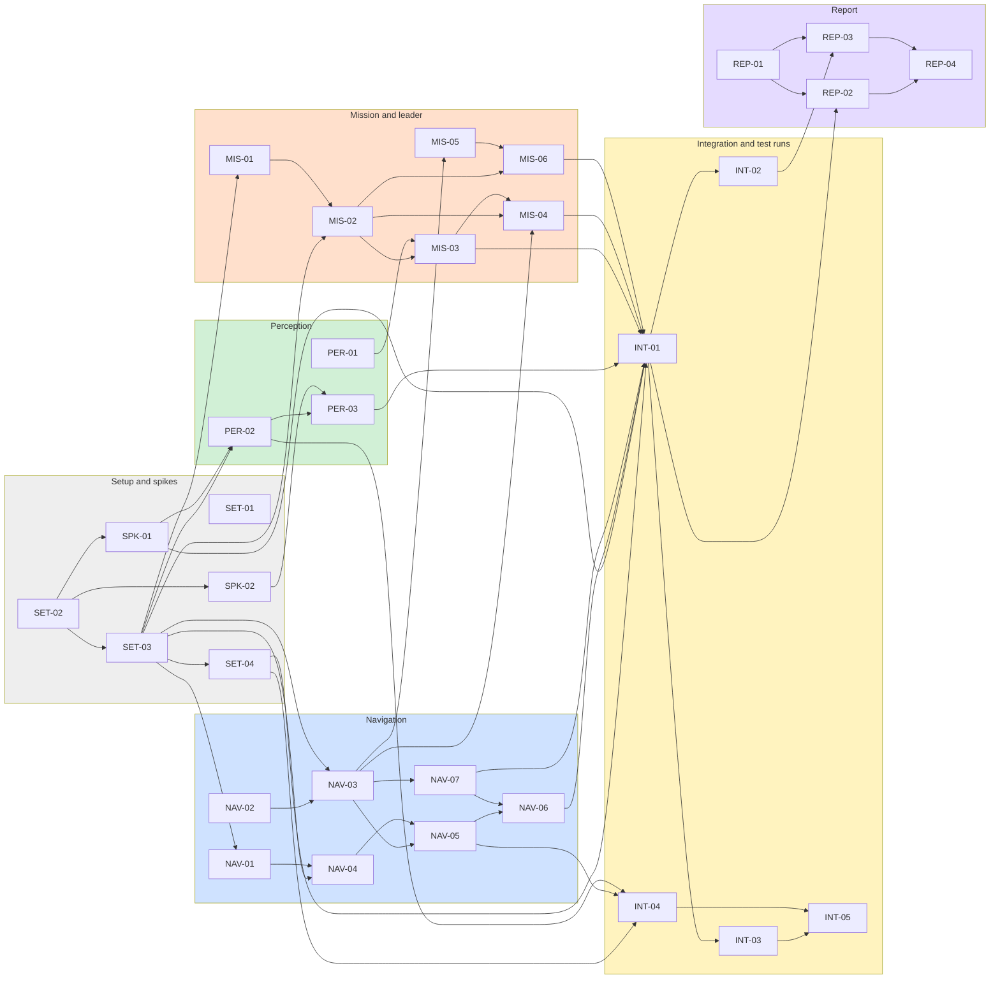

# Issues overview

Generated together with `tools/issues.csv`. 31 issues, 66 effort points.

## Keys

| Prefix | Area |
|---|---|
| `SET` | Setup: repository, environment, packages, interfaces, parameters and launch file |
| `SPK` | Spike: time-boxed investigation that answers one question before building |
| `NAV` | Navigation: grid, distance transform, paths, controller, two-robot rules, `robot_handler` |
| `PER` | Perception: marker register and `marker_detector` |
| `MIS` | Mission and leader: state machine, reporting, meeting, viewpoints, allocation, `leader` |
| `INT` | Integration and test runs |
| `REP` | Report |

The number gives the working order inside an area: an issue never depends on a higher number in the same area, except NAV-06, which wires the two-robot rules from NAV-07 into `robot_handler`.

## Labels

| Label | Meaning |
|---|---|
| `impl:own` | Core of the navigation algorithm (R7). Implemented by the issue owner without AI code generation; AI tools may be used for explanations and review. |
| `impl:ai-allowed` | AI tools may be used for code generation. The owner reviews the code and can explain it. |
| `area:*` | Part of the system the issue belongs to. |
| `owner:A/B/C` | Owner (see below). Issues without an owner label are shared. |
| `ready` | No dependencies at creation; Status set to Ready on the board. |
| `cross-area` | Depends on work by another owner. |
| `size:S/M/L` | Effort: S under 2 h, M about half a day, L a day or more. |
| `type:*` | setup, spike, core, node, test-run, docs |

Issues without code (spikes, test runs, report) have no `impl` label.

## Milestones

| Milestone | Due | Done when |
|---|---|---|
| M0 Setup, spikes and interfaces | 2026-10-23 | Environment works in the VM, spikes answered, `rescue_interfaces` frozen |
| M1 Navigation and detection on w1 | 2026-11-01 | On w1, `robot_handler` reaches hand-sent goals with distance-transform paths and spins; `marker_detector` publishes correct positions (one report sent by hand is accepted); grid, distance transform, paths, two-robot rules, marker register, viewpoints, allocation and `Mission` are unit-tested; the leader reports markers |
| M2 Competition-PC smoke test (week 45) | 2026-11-04 | On a booked Tuesday or Wednesday slot: clean clone → build as in the README → launch with `leader:=false` → both robots drive a hand-sent goal → a marker is detected → scoring prints. Tuning continues afterwards |
| M3 Full mission on all worlds (v-test) | 2026-11-06 | Full mission with two robots on all five worlds, README checked in a fresh workspace, tag `v-test` |
| M4 Competition and report (week 46) | 2026-11-15 | Competition version `v-final`, report submitted |

The smoke test (M2) only needs the launch file, path following and the marker detector, so it does not wait for the full mission (M3).

## Implementation labels

| Label | Issues |
|---|---|
| `impl:own` | NAV-02, NAV-03, NAV-05, NAV-06, NAV-07, MIS-01, MIS-04, MIS-05, MIS-06 |
| `impl:ai-allowed` | SET-03, SET-04, NAV-01, NAV-04, PER-01, PER-02, MIS-02, MIS-03, INT-03 |
| no code | SET-01, SET-02, SPK-01, SPK-02, PER-03, INT-01, INT-02, INT-04, INT-05, REP-01, REP-02, REP-03, REP-04 |

## Ready at start

| Key | Title | Area | Owner | Size |
|---|---|---|---|---|
| SET-01 | Set up repository, project board, local environment and logs | setup | shared | M |
| SET-02 | Set up ROS 2 Foxy in the VM and run the course world with scoring | setup | shared | M |
| NAV-02 | Implement `GridMap` | navigation | A | M |
| PER-01 | Implement `Sighting` and `MarkerRegistry` | perception | A | M |
| REP-01 | Report outline and figures | report | shared | M |

## Split between owners

Effort points: S = 1, M = 2, L = 4. Shared issues are taken by whoever is free.

| Owner | M0 | M1 | M2 | M3 | M4 | Total | Keys |
|---|---|---|---|---|---|---|---|
| A: navigation algorithms | — | 12 | — | — | — | 12 | NAV-02, NAV-03, NAV-07, PER-01, MIS-05 |
| B: robot node and perception | — | 11 | — | 2 | — | 13 | SET-04, NAV-01, NAV-04, NAV-05, NAV-06, PER-02, PER-03 |
| C: mission and leader | — | 8 | — | 4 | — | 12 | MIS-01, MIS-02, MIS-03, MIS-04, MIS-06 |
| Shared | 9 | — | 2 | 8 | 10 | 29 | SET-01, SET-02, SET-03, SPK-01, SPK-02, INT-01, INT-02, INT-03, INT-04, INT-05, REP-01, REP-02, REP-03, REP-04 |
| **Total** | **9** | **31** | **2** | **14** | **10** | **66** | |

## Dependency graph

Arrows point from a prerequisite to the issue that needs it.

## All issues by milestone

### M0 Setup, spikes and interfaces (due 2026-10-23)

| Key | Title | Implementation | Owner | Size | Depends on |
|---|---|---|---|---|---|
| SET-01 | Set up repository, project board, local environment and logs | — | shared | M | — |
| SET-02 | Set up ROS 2 Foxy in the VM and run the course world with scoring | — | shared | M | — |
| SET-03 | Create package skeletons, `rescue_interfaces` and type aliases | ai-allowed | shared | M | SET-02 |
| SPK-01 | Spike: odometry frame, TF lookup from a Python node, lidar offset and scoring behaviour | — | shared | S | SET-02 |
| SPK-02 | Spike: marker detection envelope, position accuracy and spin speed | — | shared | M | SET-02 |

### M1 Navigation and detection on w1 (due 2026-11-01)

| Key | Title | Implementation | Owner | Size | Depends on |
|---|---|---|---|---|---|
| SET-04 | Create `config/params.yaml` and `launch/rescue.launch.py` | ai-allowed | B | M | SET-03 |
| NAV-01 | Implement geometry helpers, lidar helpers and `GoToPointController` | ai-allowed | B | M | SET-03 |
| NAV-02 | Implement `GridMap` | own | A | M | — |
| NAV-03 | Implement the distance transform, the planner and path simplification | own | A | L | NAV-02, SET-03 |
| NAV-04 | Create `robot_handler` with the `NavigateTo` action server and the spin | ai-allowed | B | M | SET-03, NAV-01 |
| NAV-05 | Plan and follow paths in `robot_handler` | own | B | M | NAV-03, NAV-04 |
| NAV-07 | Implement the two-robot rules in `core/traffic.py` | own | A | M | NAV-03 |
| PER-01 | Implement `Sighting` and `MarkerRegistry` | ai-allowed | A | M | — |
| PER-02 | Implement the global `marker_detector` node | ai-allowed | B | M | SET-03, SPK-01 |
| PER-03 | Verify `marker_detector` against the scoring ground truth | — | B | S | PER-02, SPK-02 |
| MIS-01 | Implement the `Mission` state machine with goal deadlines | own | C | M | SET-03 |
| MIS-02 | Create the `leader` node around `Mission`, with the start-up check | ai-allowed | C | L | SET-03, MIS-01 |
| MIS-03 | Report markers to scoring from the leader | ai-allowed | C | M | MIS-02, PER-01 |
| MIS-05 | Implement viewpoint generation and `GreedyAllocator` | own | A | M | NAV-03 |

### M2 Competition-PC smoke test (week 45) (due 2026-11-04)

| Key | Title | Implementation | Owner | Size | Depends on |
|---|---|---|---|---|---|
| INT-04 | Smoke test on the competition PC | — | shared | M | SET-04, NAV-05, PER-02 |

### M3 Full mission on all worlds (v-test) (due 2026-11-06)

| Key | Title | Implementation | Owner | Size | Depends on |
|---|---|---|---|---|---|
| NAV-06 | Add the lidar safety stop, stuck recovery and two-robot rules to `robot_handler` | own | B | M | NAV-05, NAV-07 |
| MIS-04 | Meeting points and the big-fire meeting | own | C | M | MIS-02, MIS-03, NAV-03 |
| MIS-06 | Exploration with viewpoint passes in the leader | own | C | M | MIS-02, MIS-05 |
| INT-01 | First full run on w1 | — | shared | M | SET-04, SPK-01, NAV-06, NAV-07, PER-03, MIS-03, MIS-04, MIS-06 |
| INT-02 | Full runs on all five worlds and tuning | — | shared | M | INT-01 |
| INT-03 | Robust start-up, README run instructions and tag `v-test` | ai-allowed | shared | M | INT-01 |
| REP-01 | Report outline and figures | — | shared | M | — |

### M4 Competition and report (week 46) (due 2026-11-15)

| Key | Title | Implementation | Owner | Size | Depends on |
|---|---|---|---|---|---|
| INT-05 | Fix deviations, competition-day checklist and tag `v-final` | — | shared | M | INT-03, INT-04 |
| REP-02 | Report sections: communication, navigation and implementation | — | shared | L | REP-01, INT-01 |
| REP-03 | Report section: results and discussion | — | shared | M | REP-01, INT-02 |
| REP-04 | AI-use declaration, final review and submission | — | shared | M | REP-02, REP-03 |
